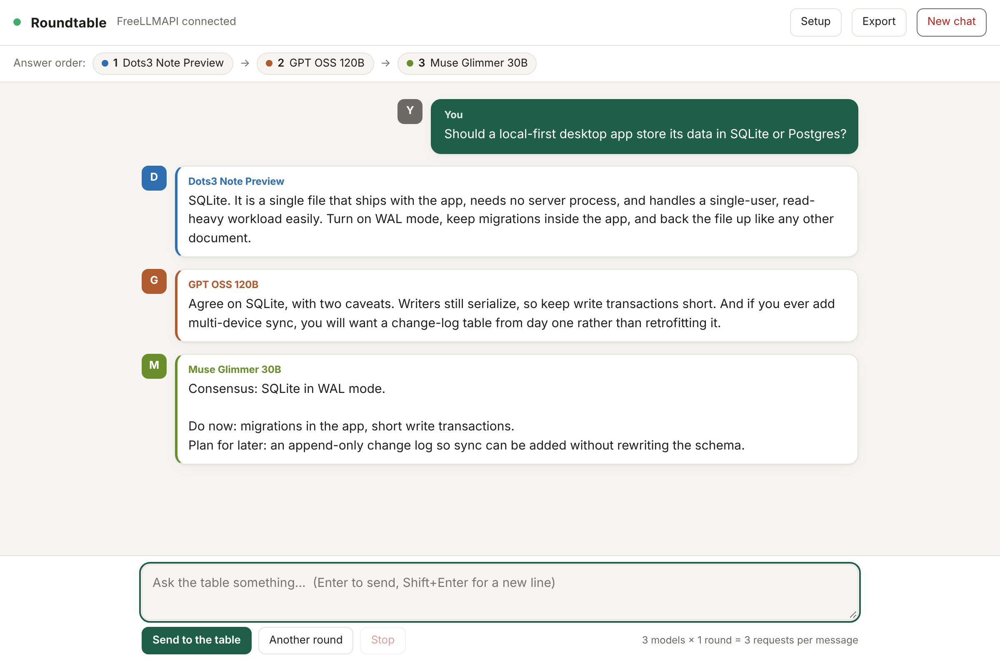

# Roundtable for FreeLLMAPI

**A collaborative group chat UI for your local and cloud LLMs via [FreeLLMAPI](https://github.com/tashfeenahmed/freellmapi), Ollama, and LM-Studio.**

Pick who sits at the table, set their order, and let models build on each other's work in real-time. Deliberation happens in one shared thread with streaming responses, live artifact generation, diff tracking, and automatic fallback.



---

## Key Features

- **Sequential & Collaborative Deliberation**: Models see peer replies in order (`Model 1 drafts` → `Model 2 critiques` → `Model 3 synthesizes`).
- **Live Artifact & Evolving Previews**: Models tagged with the `synthesizer` role produce documents, code, or web apps rendered live in a side panel (Markdown, HTML/CSS/JS sandbox, or code fences).
- **In-Memory Version History & Diff**: Step back through revisions (`v1`, `v2`, ...) with an on-demand line differ (`🔀 Diff`).
- **Local & Cloud Model Hybrid**: Auto-detects local Ollama (`:11434`) and LM-Studio (`:1234`) instances alongside your FreeLLMAPI cloud models.
- **Quota & Cost Transparency**: Calculates exact `models × rounds` request volume before dispatching.
- **Read-Only Consensus Gauge**: Real-time keyword overlap tracking (`🟢 High agreement`, `🟡 Partial agreement`, `🔴 Diverging`) to gauge convergence.
- **Multimodal Ready**: Drag-and-drop, upload, or paste (`Cmd+V` / `Ctrl+V`) images directly into prompts for vision-enabled models.
- **Privacy-First**: Zero tracking, 127.0.0.1-only local proxy, and optional session-only key storage.

---

## Choose Your Setup

| Distribution | Best For | How to Run |
| :--- | :--- | :--- |
| **macOS Native App (`.dmg`)** | macOS users (Apple Silicon & Intel) wanting a native, zero-setup desktop app | Download `Roundtable.dmg`, drag to Applications, and launch |
| **Windows Native App (`.exe`)** | Windows 11 users wanting a standalone, lightweight installer | Download `Roundtable-Setup.exe` from Releases and run |
| **Web Server (`Node.js`)** | Headless systems, servers, or local browsers | `npm start` (zero third-party dependencies) |

---

## Quick Start (Web Server)

Requires [Node.js](https://nodejs.org) 18 or newer and a running FreeLLMAPI instance or local engine (Ollama/LM-Studio).

```bash
git clone https://github.com/Just-Me-Media/FreeLLMAPI-Roundtable.git
cd FreeLLMAPI-Roundtable
npm start
```

Open <http://localhost:5173>. On initial launch, the **Setup** drawer opens:

1. **Local Models**: Click **Detect Local Models** to scan local ports (`11434` / `1234`).
2. **Cloud Models**: Enter your FreeLLMAPI unified key (`freellmapi-...`) or individual provider key and click **Load FreeLLMAPI Models**.
3. **Table Lineup**: Organize your model order and optionally assign roles (e.g., `Drafting`, `Critique`, `Synthesizer`).
4. Click **Done**. Settings persist locally in your browser.

---

## How It Works

Each participant receives an isolated, compliant view of the thread:

- **System Prompt**: Incorporates shared instructions, assigned roles, and the participant roster.
- **Merged User Turns**: Models observe peer replies formatted as `[Model Name]: ...` while maintaining standard alternating user/assistant API schemas.
- **Graceful Fallbacks**: If a provider rate-limits (429) or experiences downtime, Roundtable automatically re-routes via your designated fallback model with full provenance tagging.
- **Session History**: Save, search, and recall past conversations with the built-in **Saved Chats** drawer.

---

## Configuration

| Variable | Default | Description |
| --- | --- | --- |
| `PORT` | `5173` | Local HTTP port |
| `FREELLMAPI_URL` | Auto-detected (`:31415` or `:3001`) | Upstream FreeLLMAPI gateway endpoint |
| `FREELLMAPI_KEY` | None | Optional environment-level default key |

```bash
FREELLMAPI_URL=http://127.0.0.1:31415 PORT=5173 npm start
```

---

## Building Desktop Apps Locally

### macOS (.dmg)
Requires Rust and the Tauri CLI:
```bash
npm run build:mac
# Or to build, sign, and notarize:
./scripts/build-and-notarize.sh
```

### Windows (.exe)
Built natively via your Windows build machine (or ThinkCentre runner):
```powershell
cargo tauri build
```

---

## Security & Privacy

- The local proxy binds strictly to `127.0.0.1`.
- API credentials are stored only on the client side (in-memory by default, or opt-in `localStorage`).
- Zero telemetries, external analytics, or remote logging.

---

## Support

Roundtable is free, open source (MIT), and built and maintained by one person. If it saves you time, you can [buy me a coffee](https://buymeacoffee.com/justmemedia) to help me keep building. Bug reports, ideas, and stars on GitHub help just as much.

Roundtable is an unofficial companion to [FreeLLMAPI](https://github.com/tashfeenahmed/freellmapi). Support here goes to Roundtable, not to the FreeLLMAPI project.

* * *

## License

[MIT](LICENSE) © Just Me Media. Unofficial companion project for FreeLLMAPI.

