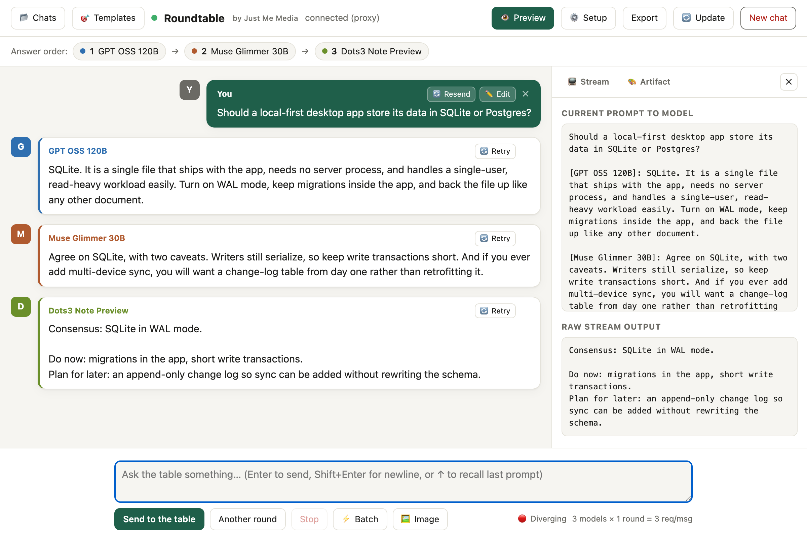

# Roundtable — One Conversation, Multiple AI Models

Send a prompt once. Each model takes a turn in the same shared conversation, reads every earlier reply, and builds on it. A designated Synthesizer produces one clean final document.

No switching between tabs. No stitching answers together yourself.



---

## Why use it

Most AI tools give you one model at a time. Roundtable runs them in sequence — a Writer drafts, a Critic finds the holes, a Researcher adds evidence, and a Synthesizer produces the final output. The result is more thorough than any single model working alone.

Works for writing, research, decisions, code review, marketing copy, study guides, product briefs, and anything else where multiple perspectives make a better answer.

---

## Key features

- **Shared conversation** — every model reads the full thread before replying, including what earlier models said
- **Role-based lineup** — assign roles like Writer, Critic, Researcher, Synthesizer; each model knows its job
- **Live artifact panel** — the Synthesizer's output renders in a side panel (Markdown, HTML, or code) with version history and line-diff
- **12 ready-made templates** — Essay, Blog Post, Decision Analysis, Code Review, Marketing Copy, Product Brief, and more — each pre-loads the right roles and instructions
- **All major providers** — OpenRouter, Groq, Google Gemini, OpenAI, Anthropic, or any OpenAI-compatible gateway (Ollama, LM Studio, FreeLLMAPI, LiteLLM)
- **Batch mode** — run multiple prompts through the full lineup and collect synthesized artifacts as a downloadable file
- **Privacy-first** — keys stored in-browser only, local proxy binds to 127.0.0.1, zero telemetry

---

## Download

### macOS — Apple Silicon and Intel
[Roundtable_0.2.4_universal.dmg](https://github.com/Just-Me-Media/FreeLLMAPI-Roundtable/releases/download/v0.2.4/Roundtable_0.2.4_universal.dmg) — requires macOS 12+, one universal build for both architectures, signed and notarized.

Or install with Homebrew:

```bash
brew install --cask just-me-media/tap/roundtable
```

Newer Homebrew versions ask you to trust third-party taps first. If it refuses or prompts, run `brew trust just-me-media/tap` once.

### Windows
[Roundtable_0.2.4_x64-setup.exe](https://github.com/Just-Me-Media/FreeLLMAPI-Roundtable/releases/download/v0.2.4/Roundtable_0.2.4_x64-setup.exe) · [.msi](https://github.com/Just-Me-Media/FreeLLMAPI-Roundtable/releases/download/v0.2.4/Roundtable_0.2.4_x64_en-US.msi) — requires Windows 10/11 64-bit

Windows installers are unsigned, so SmartScreen may show "Windows protected your PC" — choose **More info → Run anyway**.

Once installed, Roundtable checks for updates on launch and offers them with **Install** or **Later**. Nothing downloads or installs unless you choose Install.

### Web (Node.js server)
Run it in any browser — no installation needed beyond Node.js 18+.

---

## Quick start (web server)

```bash
git clone https://github.com/Just-Me-Media/FreeLLMAPI-Roundtable.git
cd FreeLLMAPI-Roundtable
npm install
npm start
```

Open <http://localhost:5173>. The Setup drawer opens automatically on first run.

1. **Add models** — go to the Cloud Models tab, pick a provider (OpenRouter is free), enter your key, and click Load Models. Or use the Local Models tab to detect Ollama or LM Studio.
2. **Apply a template** — click **🎯 Templates** in the header and choose one. It assigns roles to your models and sets focused instructions.
3. **Send a prompt** — type your question and press Enter. Models answer in order. The Synthesizer's output appears in the right panel.

---

## Model sources

| Source | Setup |
|---|---|
| **OpenRouter** | Free key at [openrouter.ai/keys](https://openrouter.ai/keys) — access to hundreds of models |
| **Groq** | Free key at [console.groq.com/keys](https://console.groq.com/keys) — very fast inference |
| **Google Gemini** | Free key at [aistudio.google.com](https://aistudio.google.com/app/apikey) |
| **OpenAI** | Key at [platform.openai.com](https://platform.openai.com/api-keys) |
| **Anthropic** | Key at [console.anthropic.com](https://console.anthropic.com/settings/keys) — add model IDs manually |
| **Ollama** | Run locally, click Detect Local Models |
| **LM Studio** | Run locally, click Detect Local Models |
| **Any OpenAI-compatible gateway** | Enter base URL in the gateway option |

---

## Templates

| Category | Templates |
|---|---|
| ✍️ Writing & Content | Essay / Report, Blog Post, Email / Pitch |
| 🧭 Thinking & Decisions | Decision Analysis, Debate Both Sides, Research Brief |
| 📋 Work & Business | Product Brief, Marketing Copy |
| 💡 Learning & Explaining | Explain This, Study Guide |
| 💻 Code & Technical | Code Review, Architecture Review |

---

## Roles

Assign any of these to a model slot. Templates assign them automatically.

| Role | What it does |
|---|---|
| ✍️ Writer | Drafts clear, focused prose |
| 🔎 Critic | Challenges claims and finds gaps |
| 📚 Researcher | Grounds claims in evidence |
| ✏️ Editor | Tightens and polishes |
| 😈 Devil's Advocate | Argues the other side |
| 🔗 Synthesizer | Produces the final document |
| 🧭 Strategist | Goals, tradeoffs, long game |
| 🎓 Domain Expert | Applies deep knowledge |
| 👤 User Advocate | Keeps real people in view |
| 🐛 Code Reviewer | Bugs, security, maintainability |
| 🏗️ Architect | Structure and design decisions |
| 🧑‍🏫 Teacher | Explains clearly for the stated audience |

---

## Configuration

| Variable | Default | Description |
|---|---|---|
| `PORT` | `5173` | Local HTTP port |
| `FREELLMAPI_URL` | Auto-detected | Base URL for an OpenAI-compatible gateway |
| `FREELLMAPI_KEY` | None | Optional default key for the gateway |

---

## Building desktop apps

### macOS
```bash
npm run build:mac     # builds .app for this Mac's architecture
npm run build:dmg     # universal .dmg, signed + notarized + stapled
npm run verify        # health checks
```

`npm run build:dmg` produces one universal binary that runs natively on both Apple Silicon and Intel Macs. It needs both Rust targets once:

```bash
rustup target add aarch64-apple-darwin x86_64-apple-darwin
```

For a faster local check that only builds this Mac's architecture:

```bash
NATIVE=1 ./scripts/build-and-notarize.sh
```

### Windows (run on Windows machine)
```powershell
powershell -ExecutionPolicy Bypass -File .\build-windows.ps1
```

---

## Security & privacy

- Local proxy binds strictly to `127.0.0.1` — not reachable from other machines
- API keys stored in-browser only (session memory by default; opt-in localStorage)
- No telemetry, no analytics, no remote logging

---

## Support

Roundtable is free, open source (MIT), and maintained by one person. If it saves you time, [buy me a coffee](https://buymeacoffee.com/justmemedia).

Questions, bugs, feature ideas: [open an issue](https://github.com/Just-Me-Media/FreeLLMAPI-Roundtable/issues) or [start a discussion](https://github.com/Just-Me-Media/FreeLLMAPI-Roundtable/discussions).

---

## License

[MIT](LICENSE) © Just Me Media
