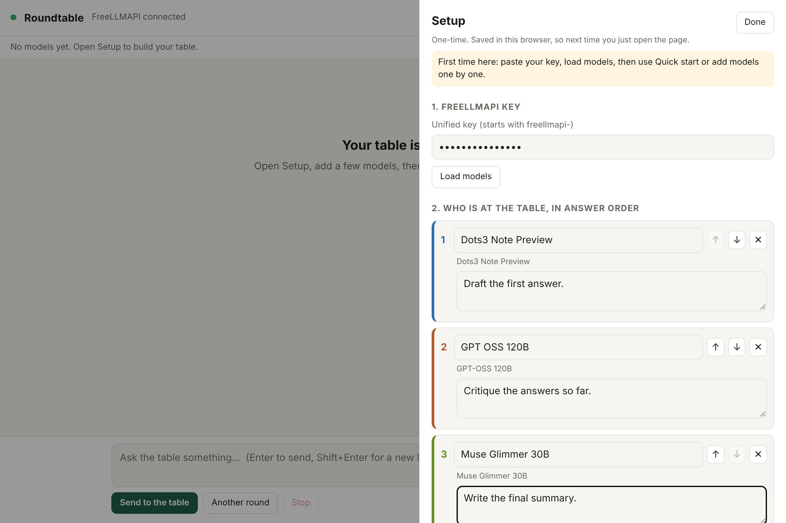

# Roundtable for FreeLLMAPI

**A shared group chat for the models behind your [FreeLLMAPI](https://github.com/tashfeenahmed/freellmapi).** Pick who sits at the table and in what order they answer, once. After that, every model sees the whole conversation, including what the other models said.


*Screenshots use a mock backend with canned replies, so the text is illustrative.*

## Why

Most multi-model UIs send the same prompt to several models and show the answers side by side. Each model answers alone and never sees the others. Roundtable puts them all in one thread: the first model drafts, the second critiques, the third summarizes, and on the next turn they can all respond to each other.

FreeLLMAPI already gives you one OpenAI-compatible endpoint for many free providers. Roundtable is a small front end for that endpoint.

## Quick start

You need [Node.js](https://nodejs.org) 18 or newer and a running FreeLLMAPI with some provider keys added.

```bash
git clone https://github.com/Just-Me-Media/FreeLLMAPI-Roundtable
cd FreeLLMAPI-Roundtable
node server.js        # or: npm start
```

Open <http://localhost:5173>. The first time, the Setup panel opens:

1. Paste your FreeLLMAPI **unified key** (it starts with `freellmapi-`) and click **Load models**.
2. Click **Quick start**, or search and add models one by one. Use the arrows to set the **answer order**.
3. Optionally give each model a **role**, such as "Draft the first answer" or "Write the final summary".
4. Click **Done**. Setup is saved in your browser, so next time you just open the page.



Roundtable looks for FreeLLMAPI on `http://127.0.0.1:3001` (Docker and `npm run dev`) and `http://127.0.0.1:31415` (desktop app), and uses whichever answers. The dot at the top turns green when it is connected.

## How it works

Each model gets its own view of the thread:

- A **system prompt** with your shared instructions, the model's name and role, and the list of participants.
- Its **own earlier replies** as `assistant` messages.
- Everyone else's replies as `user` messages tagged with the author, like `[Dots3 Note Preview]: ...`. Consecutive user turns are merged, so providers that insist on strictly alternating roles still accept the request.

Around that:

- **Rounds per message** (1 to 3). With 2 or more, the models answer, then react to each other.
- **Another round** runs one more pass with no new message from you.
- **Fallback.** If a model errors (rate limit, outage), Roundtable retries once with a model of your choice, `auto` by default. The reply is marked "via auto", and error text never enters the shared history.
- **Stop** cancels the current run and the upstream request. **Retry this model** appears on any failed reply.
- Replies stream in. Chats and setup persist across reloads. **Export** saves the chat as Markdown.

## Watch your free quotas

One message costs **models × rounds** requests. Five models and two rounds is ten requests per message, and the app shows that number under the input box. Some free tiers are small (for example, around 20 requests a day on some Gemini models), so put those models last, use fewer rounds, or leave them out.

## Configuration

| Variable | Default | What it does |
| --- | --- | --- |
| `PORT` | `5173` | Port Roundtable listens on |
| `FREELLMAPI_URL` | auto-detect `:3001`, then `:31415` | Where FreeLLMAPI lives, for example `http://192.168.1.20:3001` |
| `FREELLMAPI_KEY` | none | Unified key to use when the browser sends none |

```bash
FREELLMAPI_URL=http://192.168.1.20:3001 PORT=8080 node server.js
```

Roundtable talks to a plain OpenAI-compatible `/v1` API (`GET /v1/models` and streamed `POST /v1/chat/completions`), so it may work with other gateways too. It has only been tested against FreeLLMAPI and a mock.

## Security notes

- The server listens on **127.0.0.1 only**. Don't expose it to a network: the page holds your unified key.
- The key is saved in your browser's `localStorage` on this machine, and it is sent to FreeLLMAPI through the local proxy. Anyone with access to your browser profile can read it.
- Everything you type goes to whichever providers your FreeLLMAPI routes to. Don't put anything in a chat that you wouldn't send to those providers.

## Troubleshooting

| You see | Likely cause |
| --- | --- |
| Red dot, "FreeLLMAPI is not running" | FreeLLMAPI isn't running, or it uses another port. Set `FREELLMAPI_URL`. |
| "Cannot reach FreeLLMAPI ... ECONNREFUSED" | Same as above. The desktop app, Docker and dev mode use different ports. |
| `Invalid API key` when loading models | Use the **unified** `freellmapi-...` key from the Keys page, not a provider key or the dashboard admin key. |
| One model errors with 429 | That provider hit its free limit. Move it down, drop a round, or rely on the fallback. |
| A model passes in other tools but fails here | The model ID in Setup must match `GET /v1/models` exactly. |

## Development

```bash
npm install
npx playwright install chromium
npm test                 # runs the page in Chromium against a mock FreeLLMAPI
npm run screenshots      # regenerates docs/*.png
```

The tests start a mock FreeLLMAPI on port 41415 and Roundtable on 5199, so they never touch a real FreeLLMAPI or your own Roundtable. They check answer order, what each model receives, the fallback, rounds, persistence and Stop. The mock only covers the endpoints Roundtable uses, so if a real FreeLLMAPI build behaves differently, please open an issue.

The app is one `index.html` with no build step and no dependencies, plus a dependency-free `server.js`.

## About

This is an unofficial companion project. It is not affiliated with or endorsed by FreeLLMAPI. It was built with the help of Claude (Anthropic).

[MIT licensed](LICENSE).
